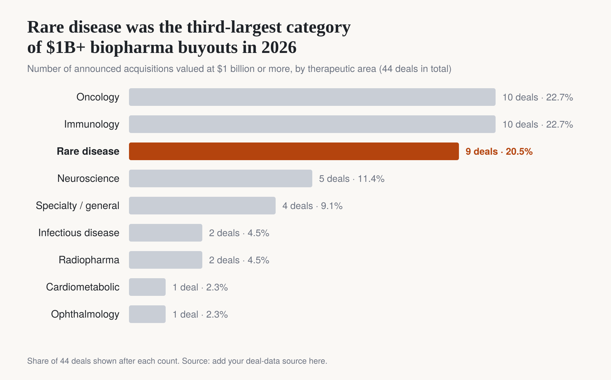

In 2026, 9 of the 44 biopharma buyouts worth $1 billion or more were for rare disease companies. They include Vertex’s $10.0 billion purchase of Crinetics Pharmaceuticals and the roughly €10.7 billion take-private of Recordati.

These deals look odd at first. A 127% premium is a lot to pay for medicines that help only a few thousand patients with conditions like acromegaly or congenital adrenal hyperplasia. A big part of the reason is regulation, not just science: rare disease drugs are shielded from several new pricing rules.

# **Blockbuster drugs now carry a deadline**

On January 1, 2026, the Inflation Reduction Act’s drug price negotiation program took effect. The first ten Medicare prices came in an average of 62.4% below list price, on drugs like Eliquis, Januvia and Entresto. The next round of 15 drugs, including Ozempic and Wegovy, starts in 2027 and is expected to cut net spending by about 44%.

Any drug for a large, common condition now has a fixed clock. Government price-setting begins 7 years after approval for small-molecule drugs and 11 years for biologics.

That hits companies already facing a $300 billion patent cliff by 2030. A new mass-market drug means accepting price cuts before the investment has paid off.

# **Rare disease drugs sit outside these rules**

Public Law 119-21, passed in late 2025, includes a provision that matters here. Starting with the 2028 cycle, drugs approved for multiple rare diseases keep their full exemption from Medicare price negotiation.

Two other rules work in the same direction:

**Part B pricing:**

 On September 30, 2026, CMS finalized its GLOBE international reference pricing model for Part B drugs. Orphan-only therapies are excluded.                                                                         

**Import tariffs:**

 Section 232 tariffs put a 100% default charge on imported patented medicines. Orphan drugs are set at 0%.

Together, these changes turn an orphan drug designation from a mark of social responsibility into real financial protection.

# **What it means for dealmakers**

When regulation squeezes drugs for large populations, assets that price controls can’t reach become more valuable. Buyers are paying for that protection.

Vertex’s $10 billion purchase of Crinetics fits this pattern. The company gets an oral acromegaly drug that Medicare can’t negotiate, that European prices can’t be used to benchmark, and that tariffs don’t touch.

This is probably the least-covered story in 2026 M&A. While most attention is on weight-loss drugs and oncology, a lot of money is moving toward regulatory protection.

Leaders in the industry should ask whether their portfolios are exposed to the statutory clock, and whether their pipelines are built around protection from it.
