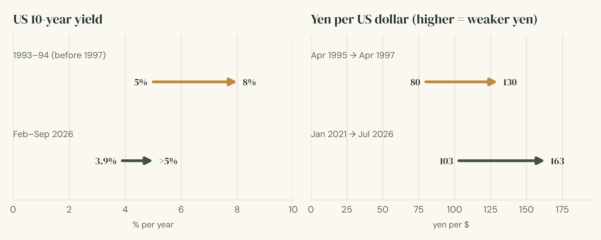
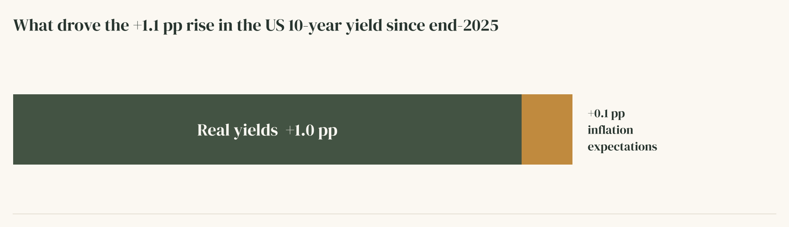
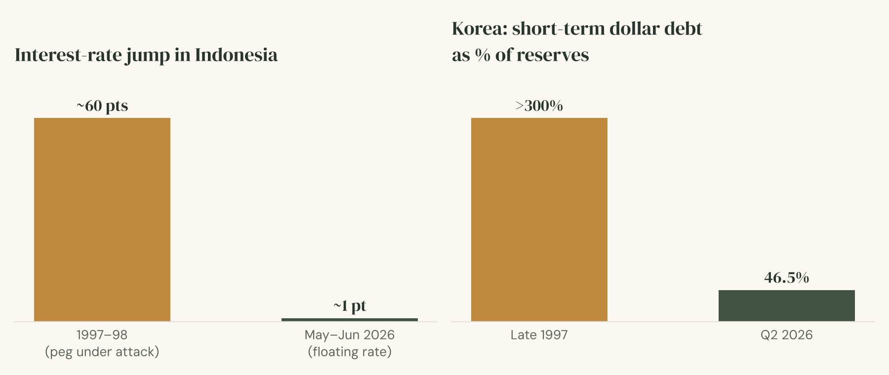
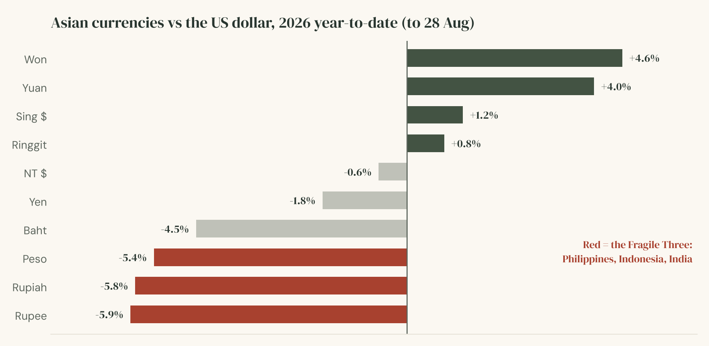

In June 1998, the Indonesian rupiah hit 16,800 per dollar. It had lost 80% of its value in a year, and the economy shrank 13%.

In June 2026, the rupiah crossed 18,000. That is a weaker number. Yet it is down only about 8% this year, Indonesia holds $146bn of reserves, and the economy is still growing.

Same number on the screen. A very different crisis underneath.

That gap is the whole story. Global bond yields have jumped, Asian currencies have slid, and 1997 keeps coming up. The question is fair: Asia delivers roughly two-thirds of world growth, so if its borrowers cannot fund themselves, everyone feels it. Here is why the comparison tempts us, and why it breaks down.

## 1. The observation: why this selloff resembles 1997

HSBC's chief Asia economist, Fred Neumann, flagged three parallels on 31 August. We found a fourth.

* **US yields are climbing.** The 10-year went from 5% to 8% in 1993–94. This year it rose from 3.9% in February to above 5% in September, its first close above 5% since 2007.
* **The yen is weak.** It slid from 80 to 130 per dollar before 1997. It has gone from 103 to 163 since 2021.
* **Tech euphoria.** The internet boom then, the AI boom now, with chips carrying Asia's exports.
* **A yen rescue.** On 31 July 2026, Washington and Tokyo bought yen together, the first time since June 1998.

> Both episodes opened with higher US yields and a weaker yen.

On this evidence, markets are right to ask whether history is repeating.

## 2. The diagnosis: same symptoms, different disease

Look at what is causing the pain and how it travels, and the match falls apart. There are three differences.

**Difference 1: the trigger is oil, not banks.**

The fuse was the Hormuz oil shock. Brent jumped 55% in March and touched $126 on 30 April. US yields then reset higher, and most of that rise came from real yields, not from fears of inflation. Heavy bond supply in the US and Japan, ¥3tn of foreign bonds sold by Japanese investors, and more than $200bn of AI-company bond issuance kept the pressure on.

> Roughly 90% of the rise in the US 10-year yield came from real yields.

**Difference 2: the plumbing changed. Pegs then, floats now.**

In 1997, currencies were pegged to the dollar. To hold a peg, central banks sold dollars and pushed rates sky-high. Indonesia's rate hit about 70%. Exports stalled, dollar-indebted banks cracked, and the peg broke anyway.

In 2026, currencies float. Instead of rates exploding, the currency falls. That cushions exporters and lets central banks hike only to contain imported inflation. Bank Indonesia added 100 basis points in a month, not 6,000. Asia is still forecast to grow 4.8% this year (IMF).

* **Then:** defend the peg, burn reserves, watch banks fail.
* **Now:** let the currency adjust, hike modestly, keep growing.
  **Difference 3: the dollar buffers are much thicker.**

Korea's short-term dollar debt was above 300% of its reserves in late 1997. In the second quarter of 2026 it was 46.5%. Thailand's reserves cover about 2.5 times its short-term external debt, whereas in 1997 it had pledged over $23bn in dollar forwards against $30bn of reserves.

> Two numbers that explain most of the difference. 

**So where does the pain land?**

It has moved. In 1997 it landed on bank and corporate balance sheets. In 2026 it lands on household budgets, treasuries and central banks, and it falls unevenly. Chip exporters such as Korea and China saw their currencies rise. Oil importers with big deficits (the Philippines, Indonesia and India) took the hit. We call them the Fragile Three.

> The region no longer trades as one block.

* **Households:** fuel and food inflation. The Philippines forecasts 6.1% CPI this year.
* **Treasuries:** costlier debt plus fuel subsidy bills, while Indonesia tries to hold its 3% deficit cap.
* **Central banks:** economists estimate the RBI has sold about $75–80bn of reserves since June.
  It is not all better. Thailand's current-account deficit reached 12% of GDP in the second quarter, wider than the 8% before 1997. That is why this is an echo and not a clean bill of health.

## 3. The conclusion: three takeaways

**1. The echoes are real, but they describe the trigger.**
Higher US and Japanese yields and a weak yen start the story. They do not decide how it ends.

**2. 1997 broke banks. 2026 squeezes budgets.**
Floating currencies and thick reserves turned a rate explosion into a currency slide. The weak spot is now the fuel bill, so the fix is targeted cash relief for vulnerable households and gradual removal of blanket fuel subsidies, not a defence of the exchange rate.

**3. Watch one signal: dollar loans.**
If banks and firms across the region cannot renew dollar loans as they fall due, the diagnosis changes and 1997 is back. Until then, central banks should keep dollars for emergencies and rehearse regional backstops such as CMIM.

- - -

*Sources: IMF Regional Economic Outlook (Oct 2026) and blog (Apr, Oct 2026); AMRO (11 Nov 2026); HSBC / F. Neumann via CNBC (Sep 2026); UHERO (Oct 2026); NBER (1998, 2000); Bank of Korea and Bank of Thailand (Q2 2026); Bank Indonesia; RBI; Reuters poll (28 Aug 2026); BIS; FRBSF (1997).*
